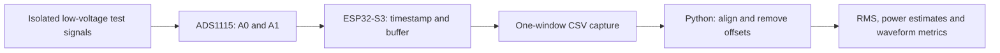

# Power Quality Meter

[](https://github.com/sreekarseera/power-quality-meter/actions/workflows/checks.yml)

[How it works](#how-the-system-works) · [Engineering decisions](#engineering-decisions-visible-in-the-code) · [Run](#run-the-software) · [Verification](#verification-and-limits)

**An ESP32-S3 and ADS1115 measurement project that makes the path from analog samples to electrical quantities visible.**

A single ADC reading cannot describe an AC waveform. RMS needs a window of samples; active power needs voltage and current values that refer to the same instant. This project explores both problems through embedded acquisition and an inspectable Python analysis pipeline.

The repository contains the supplied Arduino development stages alongside a newer timestamped acquisition implementation. The newer path records when each channel was read, aligns the channels in software and calculates AC RMS, estimated active and apparent power, power factor, frequency and voltage crest factor.

## At a glance

| Item | Current implementation |
| --- | --- |
| Controller | ESP32-S3 DevKitC-1 |
| ADC | ADS1115, I²C address 0x48, configured for 860 conversions/s |
| Acquisition | 256 sequential channel pairs per window; timestamps recorded for each channel |
| Analysis | Python 3.11+, standard library only |
| Verification | Four automated tests and a successful ESP32-S3 build on GitHub |
| Measurement evidence | Physical accuracy and calibration of the newer implementation have not been verified |
| Starting point | [Firmware](src/main.cpp) · [Analysis](tools/analyze.py) · [Verification record](VERIFICATION.md) |

**Build scope:** CI compiles the newer firmware in src/main.cpp. It does not compile every sketch in originals/, and compilation does not establish physical measurement accuracy.

## How the system works



The two inputs are sensor-level voltages. Their names indicate their intended roles: A0 represents the voltage channel and A1 represents the current channel. Neither becomes a calibrated electrical measurement merely because it has been sampled.

### 1. Acquire without hiding the timing

The firmware reads A0 and A1 sequentially, records the midpoint of each blocking read call and stores the results in memory. It prints the buffered window afterward, reducing interference from serial output during acquisition.

The ADC's 860-conversions/s setting is **not** 860 simultaneous voltage/current pairs per second. Channel switching, conversion time and software overhead affect the actual window duration. The implementation records timestamps instead of assuming that a fixed number of readings represents a particular number of AC cycles.

### 2. Align the two channels

The analysis tool linearly interpolates current-channel samples onto voltage-channel timestamps and discards samples outside their overlapping time range. It subtracts each aligned channel's mean to remove the DC midpoint bias, then applies user-supplied scale factors.

This mitigates sequential sampling skew. It cannot recover detail that was never sampled or correct phase shifts introduced by the analog sensors.

### 3. Calculate and expose the quantities

For the aligned, offset-removed samples:

| Quantity | Calculation | Interpretation |
| --- | --- | --- |
| AC RMS | Square root of the mean squared samples | Effective magnitude of each AC component |
| Active power estimate | Mean of voltage × current | Average of the aligned instantaneous products |
| Apparent power | Voltage RMS × current RMS | Product of the two effective magnitudes |
| Power factor estimate | Active / apparent power | Timing-sensitive estimate; null when the denominator is too small |
| Frequency | Interpolated positive-going crossings | Reported when at least two crossings are available |
| Voltage crest factor | Peak absolute voltage / voltage RMS | Relationship between peak and effective magnitude |

The newer analyzer does not report reactive power, harmonics, THD or certified disturbance classifications.

## Engineering decisions visible in the code

| Decision | Reason | Where to inspect it |
| --- | --- | --- |
| Buffer before printing | Keep serial formatting outside the acquisition loop | [Firmware](src/main.cpp) |
| Record both timestamps | Expose the sequential nature of the ADC | [Firmware](src/main.cpp) |
| Interpolate before computing power | Reduce the effect of channel sampling skew | [analyze()](tools/analyze.py) |
| Leave calibration at 1 by default | Avoid silently presenting sensor volts as calibrated mains quantities | [CLI and output fields](tools/analyze.py) |
| Reject questionable captures | Catch non-finite values, repeated timestamps and inputs near the configured bench rail | [Validation](tools/analyze.py) |
| Test phase-shifted waveforms | Check more than a convenient unity-power-factor case | [Signal tests](tests/test_analysis.py) |

These are concrete examples of embedded data acquisition, signal processing, numerical validation and hardware/software interface design. Their implementation can be reviewed separately from any claim about physical instrument accuracy.

## Run the software

### Requirements

- Python 3.11 or newer; no third-party Python packages.
- PlatformIO Core 6.1.18 for the embedded build.
- The matching ESP32-S3 board for upload and live acquisition.

The build pins Espressif32 platform 6.9.0 and Adafruit ADS1X15 2.5.0 in [platformio.ini](platformio.ini).

Clone the repository, then run the software checks and build:

```sh
git clone https://github.com/sreekarseera/power-quality-meter.git
cd power-quality-meter
python3 -m unittest discover -s tests -v
python3 -m pip install platformio==6.1.18
pio run
```

With the correct board connected:

```sh
pio run -t upload
pio device monitor
```

The serial monitor runs at 115200 baud. A missing ADC produces an error and halts acquisition rather than printing measurements.

### Capture one window

Save exactly one CSV window to a file such as capture.csv:

```csv
t_v_us,sensor_v,t_i_us,sensor_i
```

The header above describes the format; it is not an experimental dataset. Copy all numeric rows from one emitted window, ending before the next header. Lines beginning with # may remain in the file.

Timestamps are in microseconds relative to that window; both signal columns are ADC input voltages. Timestamps reset for the next window, so do not concatenate windows into one analysis file.

```sh
python3 tools/analyze.py capture.csv
```

The JSON output includes sample count, observed duration, scale factors, AC RMS, power estimates, frequency and crest factor. Output fields ending in _scaled retain that naming to make calibration explicit.

### Apply measured calibration

Both scale factors default to 1. With those defaults, the results remain in sensor-voltage-derived units.

For each channel, determine a scale factor from a known reference quantity and the corresponding sensor AC RMS. Supply the independently established positive factors through --voltage-scale and --current-scale. A gain calibration does not remove phase error; validate that separately before interpreting power factor.

The [bench procedure](docs/bench-procedure.md) explains what to record during calibration and comparison.

## Hardware interface and operating boundary

| Connection | ESP32-S3 / setting |
| --- | --- |
| ADS1115 VDD | 3.3 V |
| ADS1115 GND | Common logic ground |
| ADS1115 SDA | GPIO 8 |
| ADS1115 SCL | GPIO 9 |
| ADS1115 ADDR | Ground, selecting 0x48 |
| Channel A0 | Voltage-representing bench signal |
| Channel A1 | Current-representing bench signal |

Use isolated, current-limited low-voltage signals within the ADC input limits. The selected ±4.096 V gain range does not permit input voltages beyond the 3.3 V-powered device's safe limits. The analyzer conservatively rejects readings below 0 V or at/above 3.25 V.

The supplied [wiring reference](originals/hardware/schematics/esp32_s3_pinout_wiring.md) and [circuit image](originals/documents/images/Reference%20Circuit%20Diagram.png) document original material; they are not a safety certification. The current bench procedure does not instruct direct mains connection.

## Verification and limits

The four tests cover:

- Sine-wave RMS, frequency and near-unity power factor.
- A phase-shifted signal with the expected power factor.
- Constant inputs with no AC power or frequency.
- Repeated timestamps, non-finite values and near-rail readings.

Tests generate synthetic signals in memory. [GitHub Actions](.github/workflows/checks.yml) also builds the newer ESP32-S3 firmware. See [VERIFICATION.md](VERIFICATION.md) for recorded runs.

The remaining measurement questions are physical: sensor calibration, analog phase response, noise, clipping, sampling jitter and agreement with reference instruments. The analyzer uses sample means rather than time-weighted integration, so irregular sampling also needs evaluation. No verified raw bench-capture dataset is included.

This is an educational acquisition and analysis system. It is not presented as a certified power-quality instrument.

## Repository guide

| Path | Purpose |
| --- | --- |
| [src/main.cpp](src/main.cpp) | New timestamped ADC acquisition |
| [tools/analyze.py](tools/analyze.py) | CSV validation, alignment and signal calculations |
| [tests/test_analysis.py](tests/test_analysis.py) | Synthetic signal and invalid-input tests |
| [originals/firmware/code/](originals/firmware/code/) | Supplied scanner, raw-sampler, RMS and meter sketches |
| [SOURCE_MANIFEST.json](SOURCE_MANIFEST.json) | Hashes and archive paths for preserved source files |
| [docs/bench-procedure.md](docs/bench-procedure.md) | Low-voltage verification procedure |

## Source, assistance and reuse

Supplied Arduino sketches are preserved byte-for-byte in originals/. The newer acquisition and analysis implementation was prepared with AI assistance on 29 October 2026; it is not presented as earlier student-authored work. See the [contribution record](docs/attribution.md).

Reuse terms have not been assigned across all material. Read [LICENSE.md](LICENSE.md) before redistributing or licensing supplied files.
